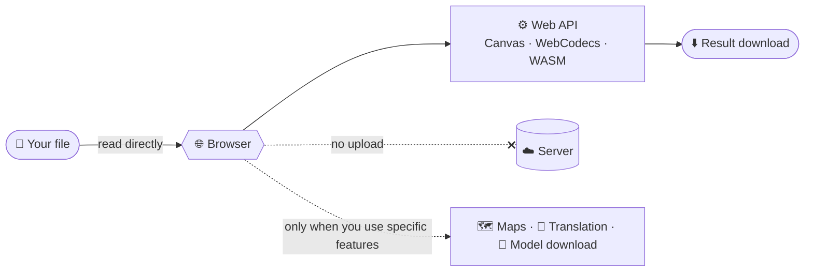
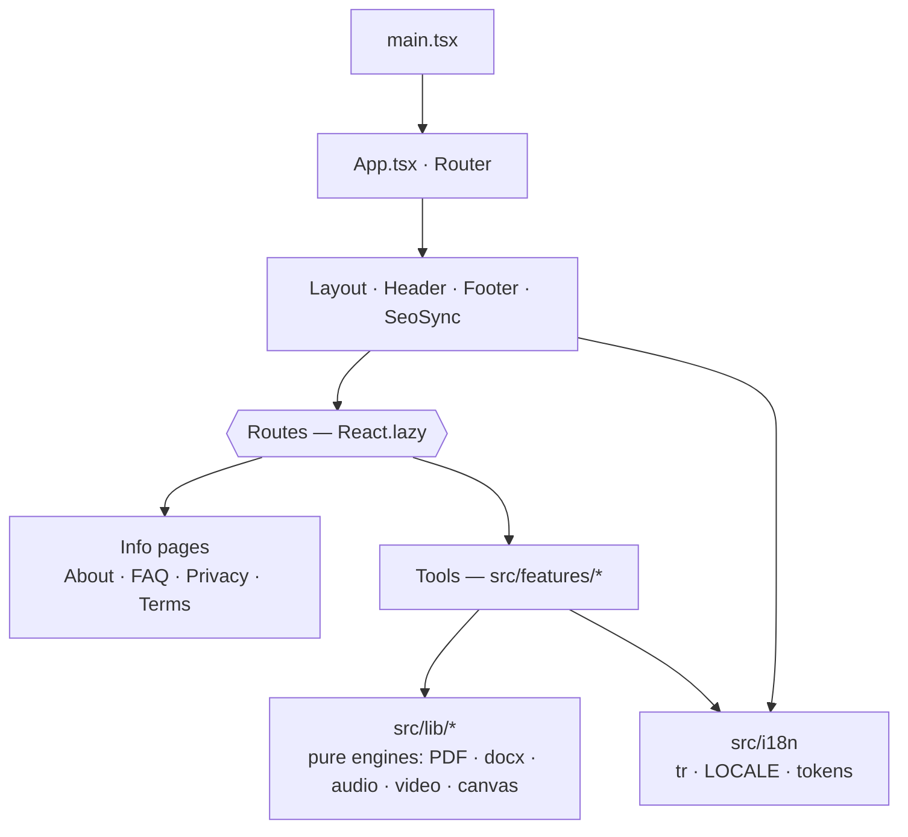

<div align="center">



<br />

[🇮🇩 Bahasa Indonesia](README.md) · **🇬🇧 English**

<br />

[](CHANGELOG.md)
[](#-tool-catalog)
[](#-bilingual-id--en)
[](#-privacy-by-design)

[](https://react.dev)
[](https://www.typescriptlang.org)
[](https://vite.dev)
[](https://tailwindcss.com)
[](#-performance--lighthouse)

### One place for every digital tool — processed on your device, not on a server.

[**🚀 Open the site**](https://gamatopiranti.zone.id) &nbsp;·&nbsp; [**❓ FAQ**](https://gamatopiranti.zone.id/faq) &nbsp;·&nbsp; [**🔒 Privacy**](https://gamatopiranti.zone.id/privacy) &nbsp;·&nbsp; [**🐞 Report a bug**](https://github.com/wisma-develop/Gamato-Piranti/issues)

</div>


## 📑 Table of contents

<table>
<tr>
<td valign="top">

- [✨ At a glance](#-at-a-glance)
- [🧭 Tool catalog](#-tool-catalog)
- [🔒 Privacy by design](#-privacy-by-design)
- [🌐 Bilingual (ID · EN)](#-bilingual-id--en)

</td>
<td valign="top">

- [⚡ Performance & Lighthouse](#-performance--lighthouse)
- [🚀 Quick start](#-quick-start)
- [🏗️ Architecture](#️-architecture)
- [🗂️ Project structure](#️-project-structure)

</td>
<td valign="top">

- [🧩 Adding a new tool](#-adding-a-new-tool)
- [🌍 Adding / editing translations](#-adding--editing-translations)
- [☁️ Deploy](#️-deploy)
- [🤝 Contributing](#-contributing)

</td>
</tr>
</table>

## ✨ At a glance

| | |
|---|---|
| 🧰 **98 tools, 8 categories** | Code, Documents (PDF), Office, Image, Video, Audio, Utilities, and Special (business documents) |
| 🔒 **0 bytes uploaded** | Files are processed right in the browser via modern Web APIs — no processing server |
| 🧑‍💻 **No account** | No login, ads, analytics, or tracking cookies |
| 🌐 **Truly bilingual** | Interface, document templates, error messages, tokens, month/day names, even "amount in words" — ID and EN |
| 🌓 **Light/dark mode** | Light by default; your choice is remembered |
| ⚡ **Light** | Every tool loads on demand (lazy-loaded) — the first page stays fast |
| ♿ **Accessible** | Keyboard navigation, visible focus, ARIA labels, preserved contrast, `prefers-reduced-motion` respected |

> 💡 **Tip:** press <kbd>Ctrl</kbd> + <kbd>K</kbd> (or <kbd>⌘</kbd> + <kbd>K</kbd>) anywhere to search tools — search understands ID ⇄ EN synonyms (e.g. "compress" = "kompres").

## 🧭 Tool catalog

<details open>
<summary><b>📦 Summary by category</b></summary>

| Category | Tools | Highlights |
|---|:--:|---|
| 🔳 **Code** | 5 | Fully custom QR (dot/corner shapes, colors, logo), 21-format barcodes + bulk PDF/ZIP printing, bulk QR (ZIP), multi-code QR/barcode scanner with smart results, HID scanner input + recap, Morse code + tap practice |
| 📄 **Documents** | 28 | Merge/split/compress/edit/sign/watermark/protect/redact PDF, Office ⇄ PDF conversion, OCR, document scan, document reader |
| 🗂️ **Office** | 4 | Doc, Sheet (formulas + .xlsx), Slide, plus Diagram & Formula (Mermaid + LaTeX) |
| 🖼️ **Image** | 21 | Photo Editor (30+ presets), collage (46 templates), photo print, background removal, watermark, memes, compress/resize/convert, RAW photos, documents → images |
| 🎬 **Video** | 8 | Convert, compress (5-second test), trim, crop, subtitles, merge + transitions, speed & filters, thumbnail |
| 🎧 **Audio** | 9 | Convert, Opus compression, waveform editor, visualizer (transparent .mov), Whisper transcripts, speech ⇄ text, sound meter |
| 🧮 **Utilities** | 13 | Calculators (tax, interest, investment, installments, COGS), universal converter, world dictionary, coordinates, website capture, file printing, JSON/Base64, passwords & tokens |
| 🎫 **Special** | 10 | Receipts, invoices, sales slips, business cards, name tags, coupons & tickets, letters (17 templates), certificates, CVs, WA links — many support **bulk mode** |

</details>

<details>
<summary><b>🔳 Code — QR, barcode, scanner</b></summary>

- **QR Code** — URL/text/WiFi/email/phone/SMS/WhatsApp/vCard/location/event/crypto templates; dot shapes, outer/inner corners, colors & gradients, center logo, "SCAN ME" frame; PNG/JPG/WEBP/SVG export
- **Barcode** — 21 formats (CODE128 A/B/C, EAN-13/8/5/2, UPC-A/E, ITF/ITF-14, MSI, CODE39/93, Codabar, Pharmacode) · real-time preview · automatic check digits with one-click fix · PNG (1–8×)/SVG/copy export · bulk PDF/ZIP from a list or number series
- **Scanner** — many images/paste Ctrl+V/camera (torch, zoom, beep) · many codes per image with numbered boxes · smart results (WiFi, contact, calendar, SMS, location, suspicious-link warnings) · CSV/TXT/JSON history export
- **HID scanner** (USB/Bluetooth) — duplicate policy, quantity recap, scanners without Enter, persistent log, formula-injection-safe CSV · **Morse code** — prosigns, Farnsworth, signal lamp, tap practice, `.wav` audio

</details>

<details>
<summary><b>📄 Documents — PDF Lab</b></summary>

- **Page tools:** merge, split, extract, delete, rotate, reorder, page numbers
- **Conversion:** Word/Excel/PowerPoint → PDF · PDF → Word/Excel/images · images/text/HTML → PDF
- **Security & annotation:** edit, sign, watermark, lock (flatten), unlock permissions, **permanent redaction**
- **Read & scan:** OCR (Tesseract), camera scan → PDF, document reader
- **Compress Documents:** PDF, DOCX/XLSX/PPTX/ODT/EPUB/ZIP, images, text — batch + ZIP, output is never larger than the original

</details>

<details>
<summary><b>🖼️ Image · 🎬 Video · 🎧 Audio</b></summary>

- **Image:** Photo Editor, Collage (46 templates + free mode), Photo Print (2×3, 3×4, 4R…), Background Removal, Watermark, Memes, Crop, Compress, Resize, Convert, Metadata Removal, RAW → JPEG, Documents → Images (PDF/Word/PPT/Excel/text)
- **Video:** browser-native pipeline (video + canvas + MediaRecorder / mediabunny) — no upload
- **Audio:** waveform editor (EQ, compressor, reverb, markers), in-browser **Whisper** transcripts (SRT/VTT/DOCX/PDF…), 13-style visualizer → transparent `.mov`

</details>

<details>
<summary><b>🧮 Utilities · 🎫 Special · 🗂️ Office</b></summary>

- **Utilities:** Calculator (8 modes), Universal Converter, World Dictionary, **Coordinates** (DD/DMS/UTM/MGRS/Plus Code/Geohash, GeoJSON/KML/GPX import/export), Website Capture, Print Files & Documents, HTML Preview, JSON/Base64, bulk text, statistics, passwords & tokens
- **Special:** print-ready business documents — with logo, signature, PNG & PDF; **bulk** from CSV/XLSX for business cards, name tags, coupons, certificates, letters
- **Office:** Doc Studio, Sheet Studio, Slide Studio, Diagram & Rumus Studio

</details>

## 🔒 Privacy by design



- **No processing backend.** The site is static (SPA) — no endpoint receives your files.
- **Local storage only:** language, theme, autosaved drafts, and the model cache live in `localStorage`/browser cache.
- **Outgoing requests** only for: Google Fonts (generator fonts), maps/search/elevation in the Coordinates tool, the World Dictionary (MyMemory), and Whisper/OCR model downloads — all detailed in the [Privacy Policy](https://gamatopiranti.zone.id/privacy).
- **Security headers** (CSP, HSTS, `nosniff`, Permissions-Policy) live in [`public/_headers`](public/_headers).

## 🌐 Bilingual (ID · EN)

The whole site is available in **Indonesian** and **English** — including menus, letter/CV/certificate templates, field labels, error messages, month & day names, and the *amount in words* on receipts.

| How to choose | Details |
|---|---|
| **ID \| EN switch** | in the top bar (and the mobile menu); the page reloads so all text stays consistent |
| **URL parameter** | `?lang=en` or `?lang=id` (saved to the browser) |
| **Default** | Indonesian, until the user chooses otherwise |

<details>
<summary><b>How does it work?</b></summary>

```text
src/i18n/index.ts   →  tr("Indonesian text", ...args)   // ID mode: text as-is · EN mode: dictionary
src/i18n/en.ts      →  { "Indonesian text": "English text", "{0} file¦{0} files": … }
src/i18n/tokens.ts  →  token aliases {nama}⇄{name}, {{perihal}}⇄{{subject}}, …
```

- The source text is Indonesian; `tr()` returns the translation when available, otherwise falls back to the original (never empty/erroring).
- The EN dictionary is loaded **dynamically (top-level await) only when the language = EN** → ID users pay nothing for it.
- Placeholders `{0}`, `{1}`; plurals are written `singular¦plural`.

</details>

## ⚡ Performance & Lighthouse

| Page | Device | Performance | Accessibility | Best Practices | SEO |
|---|:--:|:--:|:--:|:--:|:--:|
| Home | 🖥️ Desktop | 96 – 100 ¹ | **100** | **100** | **100** |
| Home | 📱 Mobile | 72 – 88 ¹ | **100** | **100** | **100** |
| About · FAQ · Privacy · Terms | 🖥️ Desktop | 99 – 100 ¹ | **100** | **100** | **100** |

<sub>¹ Mobile performance follows the tester machine's CPU speed (simulated 4× throttling); on both v2.15 and v2.16 results moved within the same range in our test environment. Run Lighthouse on your own device for relevant numbers.</sub>

Strategy: code is split per route (`React.lazy`), UI fonts are self-hosted & preloaded, **generator Google Fonts load only when a tool is opened**, the EN dictionary loads only in EN mode, and images/icons have fixed sizes to prevent *layout shift*.

> Measured with Lighthouse 13 (headless Chromium) against a local production build.

## 🚀 Quick start

```bash
# Prerequisites: Node.js ≥ 20.19 (or ≥ 22.12) and npm
npm install
npm run dev        # dev server → http://localhost:5173
```

| Command | What it does |
|---|---|
| `npm run dev` | Vite dev server (HMR) |
| `npm run build` | Production build into `dist/` (auto-generates `sitemap.xml`) |
| `npm run preview` | Serves the build locally |
| `npx tsc --noEmit` | Type check |

## 🏗️ Architecture



- **SPA + `React.lazy`** — one route = one code chunk.
- **Pure engines in `src/lib`** (no React) — easy to test and reuse across tools.
- **One source of truth for the menu:** `menuGroups` in `Header.tsx` → used for navigation, search, the About page, and `sitemap.xml`.

## 🗂️ Project structure

```text
.
├─ docs/assets/            # README banner & divider (animated SVG)
├─ public/                 # _headers, robots.txt, sitemap.xml, llms.txt, fonts/, ikon
├─ scripts/gen-sitemap.mjs # builds the sitemap from the routes in App.tsx
├─ src/
│  ├─ App.tsx              # route definitions (lazy)
│  ├─ components/          # layout/, ui/, search/, home/, …
│  ├─ features/            # one folder per tool category (pdf/, image/, audio/, video/, special/, …)
│  ├─ hooks/               # useDocMeta, useDarkMode, useAutosave, …
│  ├─ i18n/                # index.ts (tr), en.ts (EN dictionary), tokens.ts (token aliases)
│  ├─ lib/                 # pure engines & helpers
│  ├─ pages/               # Home, About, Faq, Privacy, Terms (+ content/faq.ts)
│  └─ utils/               # cn, sanitize, …
├─ index.html              # SEO meta, pre-paint theme & language scripts
├─ vercel.json             # SPA rewrite + cache headers
└─ vite.config.ts
```

## 🧩 Adding a new tool

1. Create a component in `src/features/<category>/ToolName.tsx` (wrap it with `PageShell`).
2. Register a `lazy` route in `src/App.tsx`.
3. Add an item to `menuGroups` in `src/components/layout/Header.tsx` — it automatically appears in the menu, search, the About page, and the sitemap.
4. Wrap every display string with `tr("…")`, then add its translation to `src/i18n/en.ts`.

## 🌍 Adding / editing translations

```ts
import { tr } from "@/i18n";

<button>{tr("Unduh hasil")}</button>                        // JSX
setInfo(tr("{0} berkas berhasil digabung.", files.length));  // placeholder
// en.ts:  "{0} berkas berhasil digabung.": "{0} file merged.¦{0} files merged."   ← plural
```

- Text missing from `en.ts` still renders (in Indonesian) — so it never causes a blank screen.
- Coverage debugging: in EN mode, define `window.__gpMiss = new Set()` before the page loads (e.g. via Playwright `addInitScript`) to collect untranslated keys.
- Module-level values (menus, templates) are computed at load time — which is why switching language reloads the page.

## ☁️ Deploy

| Platform | Notes |
|---|---|
| **Vercel** | Import the repo → *Vite* framework → done. `vercel.json` already contains the SPA rewrite |
| **Netlify / Cloudflare Pages** | Build command `npm run build`, directory `dist`; `public/_redirects` + `_headers` are prepared |
| **GitHub Pages / other static hosts** | Serve `dist/` with an `index.html` fallback for every route |

## 🤝 Contributing

- 🐞 **Found a bug?** Open an [Issue](https://github.com/wisma-develop/Gamato-Piranti/issues) — mention the tool, browser, and steps.
- 💡 **Feature idea / translation fix?** Issues and Pull Requests are welcome.
- ✅ Before a PR: `npx tsc --noEmit` and `npm run build` must pass, and test the tool you changed in **both languages**.


<div align="center">

Made with ❤️ by **[WisDev](https://gamatopiranti.zone.id/about)** · © 2026 Gamato Piranti

<sub>Standing on the shoulders of open-source projects: React · Vite · Tailwind CSS · pdf-lib · PDF.js · docx · Tesseract.js · Whisper · mediabunny · Mermaid · KaTeX · Leaflet · JSZip</sub>

</div>
