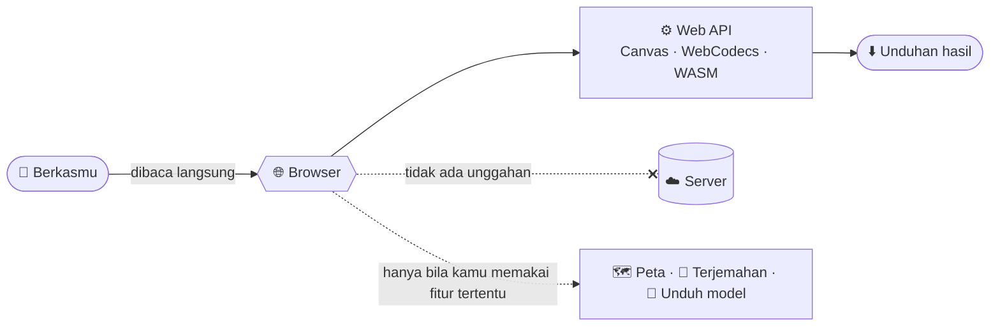
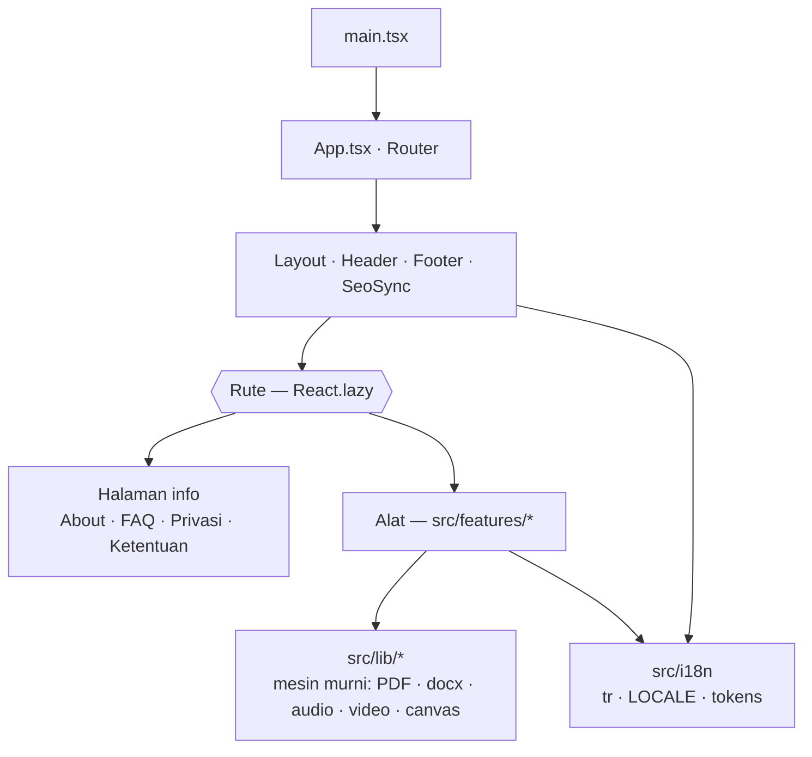

<div align="center">



<br />

**🇮🇩 Bahasa Indonesia** · [🇬🇧 English](README.en.md)

<br />

[](CHANGELOG.md)
[](#-katalog-alat)
[](#-dua-bahasa-id--en)
[](#-privasi-by-design)

[](https://react.dev)
[](https://www.typescriptlang.org)
[](https://vite.dev)
[](https://tailwindcss.com)
[](#-performa--lighthouse)

### Satu tempat untuk semua alat digital — diproses di perangkatmu, bukan di server.

[**🚀 Buka situs**](https://gamatopiranti.zone.id) &nbsp;·&nbsp; [**❓ FAQ**](https://gamatopiranti.zone.id/faq) &nbsp;·&nbsp; [**🔒 Privasi**](https://gamatopiranti.zone.id/privacy) &nbsp;·&nbsp; [**🐞 Laporkan bug**](https://github.com/wisma-develop/Gamato-Piranti/issues)

</div>


## 📑 Daftar isi

<table>
<tr>
<td valign="top">

- [✨ Sekilas](#-sekilas)
- [🧭 Katalog alat](#-katalog-alat)
- [🔒 Privasi by design](#-privasi-by-design)
- [🌐 Dua bahasa (ID · EN)](#-dua-bahasa-id--en)

</td>
<td valign="top">

- [⚡ Performa & Lighthouse](#-performa--lighthouse)
- [🚀 Mulai cepat](#-mulai-cepat)
- [🏗️ Arsitektur](#️-arsitektur)
- [🗂️ Struktur proyek](#️-struktur-proyek)

</td>
<td valign="top">

- [🧩 Menambah alat baru](#-menambah-alat-baru)
- [🌍 Menambah / mengubah terjemahan](#-menambah--mengubah-terjemahan)
- [☁️ Deploy](#️-deploy)
- [🤝 Berkontribusi](#-berkontribusi)

</td>
</tr>
</table>

## ✨ Sekilas

| | |
|---|---|
| 🧰 **98 alat, 8 kategori** | Kode, Dokumen (PDF), Office, Gambar, Video, Audio, Utilitas, dan Spesial (dokumen bisnis) |
| 🔒 **0 byte diunggah** | Berkas diproses langsung di browser lewat Web API modern — tanpa server pemroses |
| 🧑‍💻 **Tanpa akun** | Tidak ada login, iklan, analitik, atau cookie pelacak |
| 🌐 **Dua bahasa utuh** | Antarmuka, template dokumen, pesan galat, token, bulan/hari, hingga "terbilang" — ID dan EN |
| 🌓 **Mode terang/gelap** | Bawaan terang; pilihan diingat |
| ⚡ **Ringan** | Setiap alat dimuat sesuai kebutuhan (lazy-load) — halaman awal tetap cepat |
| ♿ **Dapat diakses** | Navigasi keyboard, fokus terlihat, label ARIA, kontras terjaga, `prefers-reduced-motion` dihormati |

> 💡 **Tips:** tekan <kbd>Ctrl</kbd> + <kbd>K</kbd> (atau <kbd>⌘</kbd> + <kbd>K</kbd>) di mana saja untuk mencari alat — pencarian paham sinonim ID ⇄ EN (mis. "compress" = "kompres").

## 🧭 Katalog alat

<details open>
<summary><b>📦 Ringkasan per kategori</b></summary>

| Kategori | Alat | Sorotan |
|---|:--:|---|
| 🔳 **Kode** | 5 | QR kustom penuh (bentuk titik/sudut, warna, logo), barcode 21 format + cetak massal PDF/ZIP, QR massal (ZIP), pemindai QR/barcode multi-kode dengan hasil cerdas, input scanner HID + rekap, kode Morse + latihan ketuk |
| 📄 **Dokumen** | 28 | Gabung/pecah/kompres/edit/tanda tangan/watermark/proteksi/sensor PDF, konversi Office ⇄ PDF, OCR, scan dokumen, pembaca dokumen |
| 🗂️ **Office** | 4 | Doc, Sheet (rumus + .xlsx), Slide, serta Diagram & Rumus (Mermaid + LaTeX) |
| 🖼️ **Gambar** | 21 | Photo Editor (30+ preset), kolase (46 template), cetak foto, hapus latar, watermark, meme, kompres/resize/konversi, foto RAW, dokumen → gambar |
| 🎬 **Video** | 8 | Konversi, kompres (uji 5 dtk), potong, crop, subtitle, gabung + transisi, kecepatan & filter, thumbnail |
| 🎧 **Audio** | 9 | Konversi, kompres Opus, editor waveform, visualizer (.mov transparan), transkrip Whisper, speech ⇄ text, pengukur suara |
| 🧮 **Utilitas** | 13 | Kalkulator (pajak, bunga, investasi, cicilan, COGS), universal converter, kamus dunia, koordinat, capture website, cetak file, JSON/Base64, password & token |
| 🎫 **Spesial** | 10 | Kwitansi, invoice, struk, kartu nama, nametag, kupon & tiket, surat (17 template), sertifikat, CV, WA link — banyak yang mendukung **mode massal** |

</details>

<details>
<summary><b>🔳 Kode — QR, barcode, scanner</b></summary>

- **QR Code** — template URL/teks/WiFi/email/telepon/SMS/WhatsApp/vCard/lokasi/event/crypto; bentuk titik, sudut luar/dalam, warna & gradien, logo tengah, bingkai "SCAN ME"; ekspor PNG/JPG/WEBP/SVG
- **Barcode** — 21 format (CODE128 A/B/C, EAN-13/8/5/2, UPC-A/E, ITF/ITF-14, MSI, CODE39/93, Codabar, Pharmacode) · preview real-time · digit cek otomatis & perbaikan 1 klik · ekspor PNG (1–8×)/SVG/salin · cetak massal PDF/ZIP dari daftar atau deret nomor
- **Pemindai** — banyak gambar/tempel Ctrl+V/kamera (senter, zoom, bunyi) · banyak kode per gambar dengan kotak bernomor · hasil cerdas (WiFi, kontak, kalender, SMS, lokasi, peringatan link mencurigakan) · ekspor riwayat CSV/TXT/JSON
- **Scanner HID** (USB/Bluetooth) — kebijakan duplikat, rekap jumlah, scanner tanpa Enter, log tersimpan, CSV anti-injeksi rumus · **Kode Morse** — prosign, Farnsworth, lampu sinyal, latihan ketuk, audio `.wav`

</details>

<details>
<summary><b>📄 Dokumen — PDF Lab</b></summary>

- **Atur halaman:** gabung, pecah, ekstrak, hapus, putar, atur ulang, nomor halaman
- **Konversi:** Word/Excel/PowerPoint → PDF · PDF → Word/Excel/gambar · gambar/teks/HTML → PDF
- **Keamanan & anotasi:** edit, tanda tangan, watermark, kunci (flatten), buka proteksi izin, **sensor permanen**
- **Baca & scan:** OCR (Tesseract), scan kamera → PDF, pembaca dokumen
- **Kompres Dokumen:** PDF, DOCX/XLSX/PPTX/ODT/EPUB/ZIP, gambar, teks — batch + ZIP, hasil tak pernah lebih besar dari aslinya

</details>

<details>
<summary><b>🖼️ Gambar · 🎬 Video · 🎧 Audio</b></summary>

- **Gambar:** Photo Editor, Kolase (46 template + mode bebas), Cetak Foto (2×3, 3×4, 4R…), Hapus Latar, Watermark, Meme, Crop, Kompres, Resize, Konversi, Hapus Metadata, RAW → JPEG, Dokumen → Gambar (PDF/Word/PPT/Excel/teks)
- **Video:** pipeline native browser (video + canvas + MediaRecorder / mediabunny) — tanpa upload
- **Audio:** editor waveform (EQ, kompresor, reverb, marker), transkrip **Whisper** di browser (SRT/VTT/DOCX/PDF…), visualizer 13 gaya → `.mov` transparan

</details>

<details>
<summary><b>🧮 Utilitas · 🎫 Spesial · 🗂️ Office</b></summary>

- **Utilitas:** Kalkulator (8 mode), Universal Converter, Kamus Dunia, **Koordinat** (DD/DMS/UTM/MGRS/Plus Code/Geohash, impor/ekspor GeoJSON/KML/GPX), Capture Website, Cetak File & Dokumen, HTML Preview, JSON/Base64, bulk teks, statistik, password & token
- **Spesial:** dokumen bisnis siap cetak — dengan logo, tanda tangan, PNG & PDF; **massal** dari CSV/XLSX untuk kartu nama, nametag, kupon, sertifikat, surat
- **Office:** Doc Studio, Sheet Studio, Slide Studio, Diagram & Rumus Studio

</details>

## 🔒 Privasi by design



- **Tidak ada backend pemroses.** Situs ini statis (SPA) — tidak ada endpoint yang menerima berkasmu.
- **Penyimpanan lokal saja:** bahasa, tema, draf otomatis, dan cache model hidup di `localStorage`/cache browser.
- **Permintaan keluar** hanya untuk: Google Fonts (font generator), peta/pencarian/elevasi di alat Koordinat, Kamus Dunia (MyMemory), dan unduhan model Whisper/OCR — semuanya dirinci di [Kebijakan Privasi](https://gamatopiranti.zone.id/privacy).
- **Header keamanan** (CSP, HSTS, `nosniff`, Permissions-Policy) ada di [`public/_headers`](public/_headers).

## 🌐 Dua bahasa (ID · EN)

Seluruh situs tersedia dalam **Bahasa Indonesia** dan **English** — termasuk menu, template surat/CV/sertifikat, label isian, pesan galat, nama bulan & hari, dan *terbilang* pada kwitansi.

| Cara memilih | Detail |
|---|---|
| **Pemilih ID \| EN** | di bilah atas (dan menu seluler); halaman dimuat ulang agar semua teks konsisten |
| **Parameter URL** | `?lang=en` atau `?lang=id` (disimpan ke browser) |
| **Bawaan** | Indonesia, sampai pengguna memilih lain |

<details>
<summary><b>Bagaimana cara kerjanya?</b></summary>

```text
src/i18n/index.ts   →  tr("teks Indonesia", ...args)   // mode ID: teks apa adanya · mode EN: kamus
src/i18n/en.ts      →  { "teks Indonesia": "English text", "{0} file¦{0} files": … }
src/i18n/tokens.ts  →  alias token {nama}⇄{name}, {{perihal}}⇄{{subject}}, …
```

- Sumber teks = Bahasa Indonesia; `tr()` mengembalikan terjemahan bila tersedia, jika tidak jatuh ke teks asli (tidak pernah kosong/galat).
- Kamus EN dimuat **dinamis (top-level await) hanya saat bahasa = EN** → pengguna ID tidak membayar sebesar apa pun.
- Placeholder `{0}`, `{1}`; bentuk jamak ditulis `tunggal¦jamak`.

</details>

## ⚡ Performa & Lighthouse

| Halaman | Perangkat | Performance | Accessibility | Best Practices | SEO |
|---|:--:|:--:|:--:|:--:|:--:|
| Beranda | 🖥️ Desktop | 96 – 100 ¹ | **100** | **100** | **100** |
| Beranda | 📱 Mobile | 72 – 88 ¹ | **100** | **100** | **100** |
| Tentang · FAQ · Privasi · Ketentuan | 🖥️ Desktop | 99 – 100 ¹ | **100** | **100** | **100** |

<sub>¹ Performance mobile mengikuti kecepatan CPU mesin penguji (throttling 4× simulasi); pada v2.15 maupun v2.16 hasilnya bergeser dalam rentang yang sama di lingkungan uji kami. Jalankan Lighthouse sendiri di perangkatmu untuk angka yang relevan.</sub>

Strategi: kode dipecah per rute (`React.lazy`), font UI di-host sendiri & di-preload, **Google Fonts generator dimuat hanya saat sebuah alat dibuka**, kamus EN hanya dimuat pada mode EN, dan gambar/ikon di-ukur tetap untuk mencegah *layout shift*.

> Diukur dengan Lighthouse 13 (Chromium headless) terhadap build produksi lokal.

## 🚀 Mulai cepat

```bash
# Prasyarat: Node.js ≥ 20.19 (atau ≥ 22.12) dan npm
npm install
npm run dev        # server pengembangan → http://localhost:5173
```

| Perintah | Fungsi |
|---|---|
| `npm run dev` | Server pengembangan Vite (HMR) |
| `npm run build` | Build produksi ke `dist/` (otomatis membuat `sitemap.xml`) |
| `npm run preview` | Menyajikan hasil build secara lokal |
| `npx tsc --noEmit` | Pemeriksaan tipe |

## 🏗️ Arsitektur



- **SPA + `React.lazy`** — satu rute = satu potongan kode.
- **Mesin murni di `src/lib`** (tanpa React) — mudah diuji dan dipakai ulang antar-alat.
- **Satu sumber kebenaran menu:** `menuGroups` di `Header.tsx` → dipakai untuk navigasi, pencarian, halaman Tentang, dan `sitemap.xml`.

## 🗂️ Struktur proyek

```text
.
├─ docs/assets/            # banner & divider README (SVG animasi)
├─ public/                 # _headers, robots.txt, sitemap.xml, llms.txt, fonts/, ikon
├─ scripts/gen-sitemap.mjs # membuat sitemap dari rute di App.tsx
├─ src/
│  ├─ App.tsx              # definisi rute (lazy)
│  ├─ components/          # layout/, ui/, search/, home/, …
│  ├─ features/            # satu folder per kategori alat (pdf/, image/, audio/, video/, special/, …)
│  ├─ hooks/               # useDocMeta, useDarkMode, useAutosave, …
│  ├─ i18n/                # index.ts (tr), en.ts (kamus EN), tokens.ts (alias token)
│  ├─ lib/                 # mesin & helper murni
│  ├─ pages/               # Home, About, Faq, Privacy, Terms (+ content/faq.ts)
│  └─ utils/               # cn, sanitize, …
├─ index.html              # meta SEO, skrip tema & bahasa sebelum-paint
├─ vercel.json             # rewrite SPA + header cache
└─ vite.config.ts
```

## 🧩 Menambah alat baru

1. Buat komponen di `src/features/<kategori>/NamaAlat.tsx` (bungkus dengan `PageShell`).
2. Daftarkan rute `lazy` di `src/App.tsx`.
3. Tambahkan item ke `menuGroups` di `src/components/layout/Header.tsx` — otomatis muncul di menu, pencarian, halaman Tentang, dan sitemap.
4. Bungkus semua teks tampilan dengan `tr("…")`, lalu tambahkan terjemahannya ke `src/i18n/en.ts`.

## 🌍 Menambah / mengubah terjemahan

```ts
import { tr } from "@/i18n";

<button>{tr("Unduh hasil")}</button>                        // JSX
setInfo(tr("{0} berkas berhasil digabung.", files.length));  // placeholder
// en.ts:  "{0} berkas berhasil digabung.": "{0} file merged.¦{0} files merged."   ← jamak
```

- Teks yang belum ada di `en.ts` tetap tampil (Indonesia) — jadi tidak pernah menyebabkan layar kosong.
- Debug cakupan: di konsol mode EN, `window.__gpMiss = new Set()` sebelum memuat halaman akan mengumpulkan kunci yang belum diterjemahkan.
- Nilai tingkat-modul (menu, template) dihitung saat dimuat — itu sebabnya pergantian bahasa memuat ulang halaman.

## ☁️ Deploy

| Platform | Catatan |
|---|---|
| **Vercel** | Impor repo → framework *Vite* → selesai. `vercel.json` sudah berisi rewrite SPA |
| **Netlify / Cloudflare Pages** | Perintah build `npm run build`, direktori `dist`; `public/_redirects` + `_headers` sudah disiapkan |
| **GitHub Pages / statis lain** | Sajikan `dist/` dengan fallback `index.html` untuk semua rute |

## 🤝 Berkontribusi

- 🐞 **Menemukan bug?** Buka [Issue](https://github.com/wisma-develop/Gamato-Piranti/issues) — sebutkan alat, browser, dan langkahnya.
- 💡 **Ide fitur / koreksi terjemahan?** Issue atau Pull Request dipersilakan.
- ✅ Sebelum PR: `npx tsc --noEmit` dan `npm run build` harus lolos, dan uji alat yang kamu ubah di **kedua bahasa**.


<div align="center">

Dibuat dengan ❤️ oleh **[WisDev](https://gamatopiranti.zone.id/about)** · © 2026 Gamato Piranti

<sub>Berdiri di atas pundak proyek open source: React · Vite · Tailwind CSS · pdf-lib · PDF.js · docx · Tesseract.js · Whisper · mediabunny · Mermaid · KaTeX · Leaflet · JSZip</sub>

</div>
